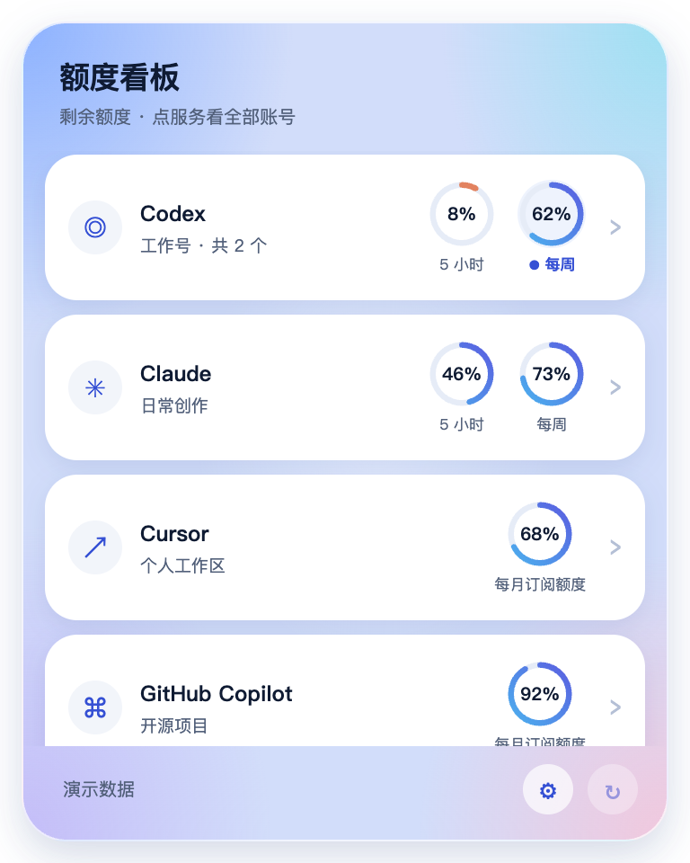

# Quota Board

为使用多个 AI 订阅账号的非程序员提供简单的桌面入口：直观看额度、快捷切换账号，并选择用不同 AI 桌面软件打开同一个项目文件夹。

面向 Windows 与 macOS 的 Electron 桌面应用，首批目标服务为 Codex、Claude、Cursor 和 GitHub Copilot，范围为账号订阅；Gemini 和按量付费的 API 余额不在范围内。当前原型包含四类服务的接入入口，各自能力见下表。Windows 默认以可拖动的悬浮球常驻，点击后展开账号面板，外圈表示所选账号与周期的已用比例。提供账号管理、5 分钟自动刷新和独立的虚拟数据演示。




截图来自 macOS 上运行的实际交互原型。Windows 实机的透明窗口、高 DPI 和多屏拖动效果仍待验证。

## 产品目标与范围

围绕四个问题设计：多个账号额度查看麻烦、桌面客户端账号切换麻烦、工具与系统配合不够自然，以及多个 AI 软件中的项目入口分散。

- 账号：在一个入口查看余量、重置时间和数据更新时间，管理多个订阅账号，并发起、确认官方桌面客户端的实际账号切换。
- 项目：添加一个已有本地文件夹，选择用不同 AI 桌面软件打开同一个目录，不因换软件复制项目文件。
- 易用性：面向非程序员，以图形引导完成日常操作，减少步骤和界面占用，分别适配 Windows 与 macOS 的交互习惯。
- 范围：不做复杂、大型 harness、多 Agent 编排、API 网关、模型路由或复杂配置界面，不把统一项目入口扩大为规则、会话或项目文件的同步工程。

**当前 v0.1 是验证原型：真实账号切换和统一项目入口尚未实现。** 面板选择账号只改变显示内容。下面涉及终端、配置目录和状态栏文件的接入步骤用于当前技术验证，尚未达到面向非程序员的目标体验。

## v0.1 的支持范围

| 服务 | 数据来源 | 多账号方式 |
| --- | --- | --- |
| Codex | 官方 CLI App Server 的额度查询 | 每个账号分别选择已登录的独立 CODEX_HOME |
| Claude | 官方 Claude Code 状态栏导出的本地额度记录 | 每个官方登录配置导出到独立文件 |
| Cursor | 用户从官方页面填写剩余百分比和重置时间 | 独立的手动记录卡片 |
| GitHub Copilot | 官方 SDK 查询已登录 CLI 的额度 | 可选择独立配置目录，实际登录身份需分别验证 |

Codex 已在开发用 Mac 上通过一次真实官方 CLI 查询，核对账号身份并返回两个额度窗口。多账号与官网逐项对照、Copilot 的真实订阅查询和 Windows 安装仍待验证。Claude 的更新依赖官方会话，Cursor 的记录由用户维护。卡片会显示数据来源、采集时间和刷新错误。无数据时显示未知，到达重置时间后需获取新读数确认。

按月订阅可能同时受小时、周或月度额度限制。每个服务按实际返回的窗口展示。只读查询会访问对应服务网络，官方 CLI 可能按自身行为刷新登录态。额度数字留在本机，项目没有自建服务端。

## 开发运行

需要 Node.js 24 LTS、npm 和 Git。

```sh
git clone --branch cross-platform https://github.com/wdfau/quota-board.git
cd quota-board
npm ci
npm start
```

初次启动显示空账号列表。点击「试用演示」可以查看五个虚拟账号，演示数据与真实账号独立。点击「返回我的账号」后添加自己的订阅。

Windows 初次启动会显示悬浮球，点击展开并选择「管理账号」开始连接订阅。选定账号及周期后，球中心与外圈显示已用额度，选择和拖动位置会保存在本机。鼠标停留可查看账号与数据时间。记录过期时显示「上次已用」，未知额度显示「—」。展开面板中的账号选择只影响悬浮球显示，官方软件的登录仍由其自身管理。

在任一系统预览悬浮球与虚拟账号

```sh
npm run demo:floating
```

```sh
npm run check
npm test
npm run test:ui
npm run test:floating
npm run pack
npm run dist
npm run dmg
```

`pack` 生成当前系统的应用目录，`dist` 生成 macOS ZIP 或 Windows 安装程序。macOS 可在构建后运行 `npm run dmg`，使用系统 hdiutil 制作 DMG。产物在 `release/`。GitHub Actions 分别在 Windows 和 macOS 构建并上传安装包 artifacts，签名及公证需配置对应开发者凭证。v0.1 的默认构建使用未签名的分发配置。

## 添加 Codex

先安装官方 Codex CLI，通过官方 `codex login` 登录订阅账号，再在看板添加 Codex 并选择「官方 CLI 查询」。程序不发起模型对话。

单账号可以留空配置目录。多账号需先在各自目录完成官方登录，然后在看板逐个选择对应目录。终端里的配置目录只对该命令生效。

macOS 的示例

```sh
CODEX_HOME="$HOME/.quota-codex-work" codex login
CODEX_HOME="$HOME/.quota-codex-personal" codex login
```

Windows PowerShell 的示例

```powershell
$env:CODEX_HOME = "$env:USERPROFILE\.quota-codex-work"
codex login
Remove-Item Env:CODEX_HOME
```

如果从桌面打开应用后找不到 CLI，在添加时选择可执行程序的绝对路径。macOS 图形应用的 PATH 可能与终端不同。Windows 支持 PATH 中的 CLI 启动器。身份在查询前后核对，首次成功后绑定到该卡片，登录变更时会清除旧快照并提示重新添加。

## 添加 Claude

先在官方 Claude Code 中登录。仓库提供的状态栏脚本仅挑选额度数字和重置时间，生成一个本地快照文件，供看板读取。

在对应 Claude 配置的 `settings.json` 中配置 `statusLine`。将下面的绝对路径替换为仓库与输出文件的位置。保留其他设置。如果已有自定义状态栏，将脚本合并进原命令或先备份。

```json
{
  "statusLine": {
    "type": "command",
    "command": "node \"/absolute/path/quota-board/scripts/claude-statusline.mjs\" \"/absolute/path/claude-work-quota.json\""
  }
}
```

Windows 路径可使用 `C:/Users/<用户名>/...`，并保留 JSON 中的引号转义。脚本需要本机 Node.js。随后在看板选择「Claude → 官方状态栏记录」，选择对应的输出 JSON 文件。

额度字段可能在官方会话获得首个响应后才出现。每个账号使用自己的官方配置和输出路径，切换官方账号时同步更换输出文件。状态栏快照没有可信账号标识，看板依赖用户配置的文件对应关系。缺少额度字段时脚本保留之前的记录，看板显示其原始采集时间。

## 添加 Cursor

添加 Cursor 卡片后，点击「官方用量」查看当前登录账号的订阅用量，再点击「更新记录」，填写窗口名称、剩余百分比和可选重置时间。每个账号创建独立卡片，官方网页里的登录账号由用户确认。首版手动记录一个主要额度窗口。

## 添加 GitHub Copilot

安装官方 Copilot CLI，并在该 CLI 内完成官方登录。添加 GitHub Copilot，选择「官方 SDK 查询」。如果需要指定可执行程序或独立配置目录，在表单中选择对应路径。Windows 需选择 Copilot 原生可执行程序（.exe），首版暂不支持 Copilot 的 .cmd / .bat 包装入口。

程序通过 SDK 的 stdio 连接调用额度查询，逐个核对官方返回的 GitHub 登录名。配额字段和 CLI 版本可能变化，当前 SDK 固定在 1.0.30。多配置目录是否隔离登录凭证需使用实际账号验证，身份不匹配的卡片会停止更新并清除旧数据。无数字配额或无限额度的窗口暂时省略。

## 本地数据

应用使用 Electron `userData` 目录的 `state.json` 保存账号别名、路径、额度和查询得到的身份标识。

- macOS 默认位置为 `~/Library/Application Support/Quota Board/`。
- Windows 默认位置为 `%APPDATA%/Quota Board/`。

官方登录由官方 CLI 管理。Claude 导出文件只包含额度和时间。仓库默认忽略登录文件、本地快照、数据库、环境变量文件和构建产物。报告问题前请删除账号名称、个人路径和邮箱等信息。

## 项目结构

```text
core/        额度校验、官方查询适配、本地持久化
src/         Electron 主进程、隔离预加载桥和看板界面
scripts/     Claude 状态栏导出与语法检查
test/        数据窗口、身份变化、失败缓存及并发删除回归验证
.github/     双系统检查和构建
```

界面使用自行绘制的图形标识，依赖按各自许可证分发。项目代码使用 MIT 许可。当前版本从零建立，没有打包个人原型或预编译 CodexBar。

## 接入依据

- Codex 使用官方 App Server 的账号与额度方法。 [官方文档](https://learn.chatgpt.com/docs/app-server)
- Claude 使用官方状态栏提供的额度字段，并遵循官方登录与凭证约束。 [状态栏](https://code.claude.com/docs/en/statusline#rate-limit-usage) · [凭证规则](https://code.claude.com/docs/en/legal-and-compliance#authentication-and-credential-use)
- Copilot 使用官方 SDK 的账号额度查询。 [SDK 用量文档](https://docs.github.com/en/copilot/how-tos/copilot-sdk/features/usage-and-billing#account-quota-and-premium-interactions)
- Cursor 个人订阅以官方用量页为准。 [用量文档](https://prod.cursor.com/help/models-and-usage/usage-limits)
